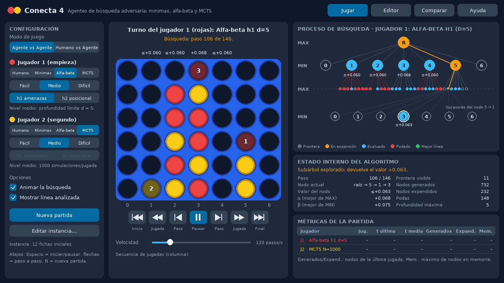
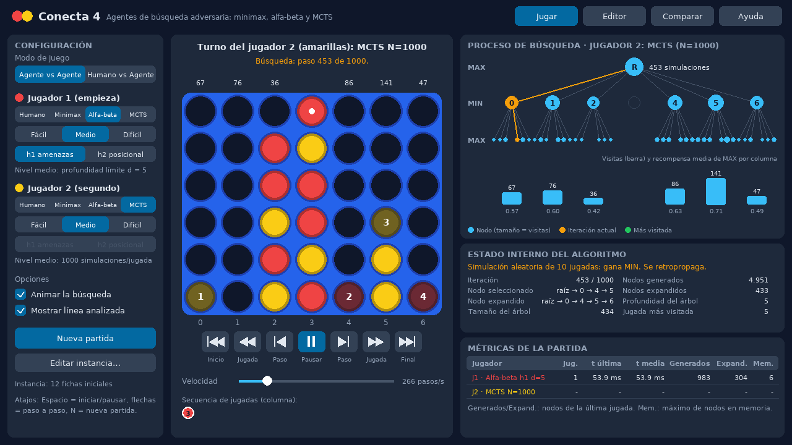
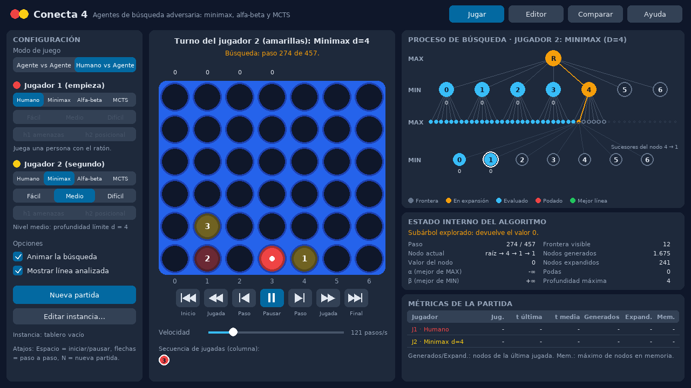
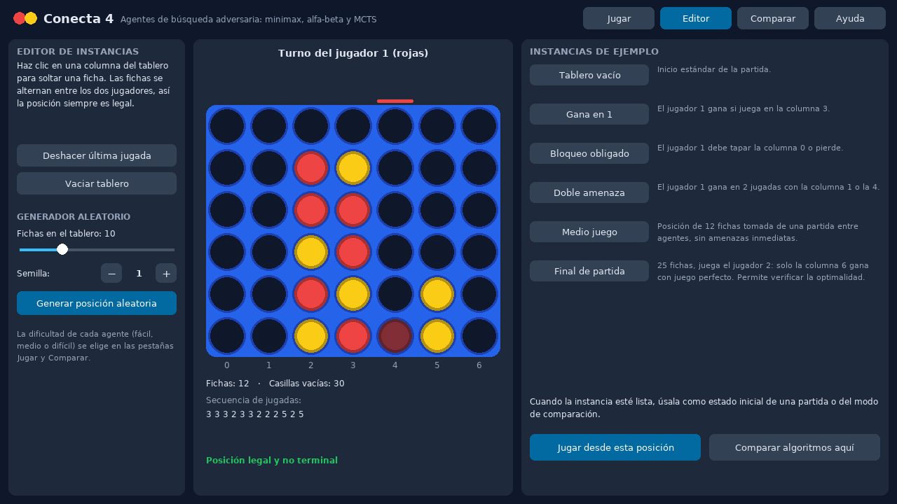
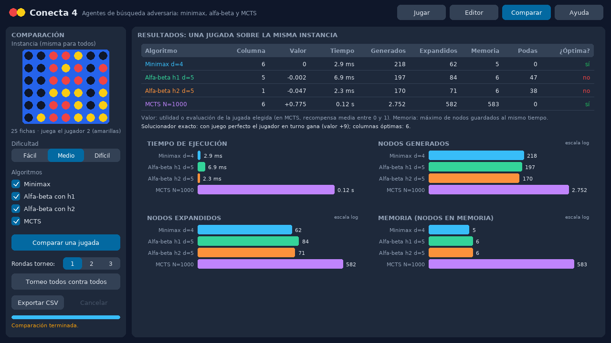
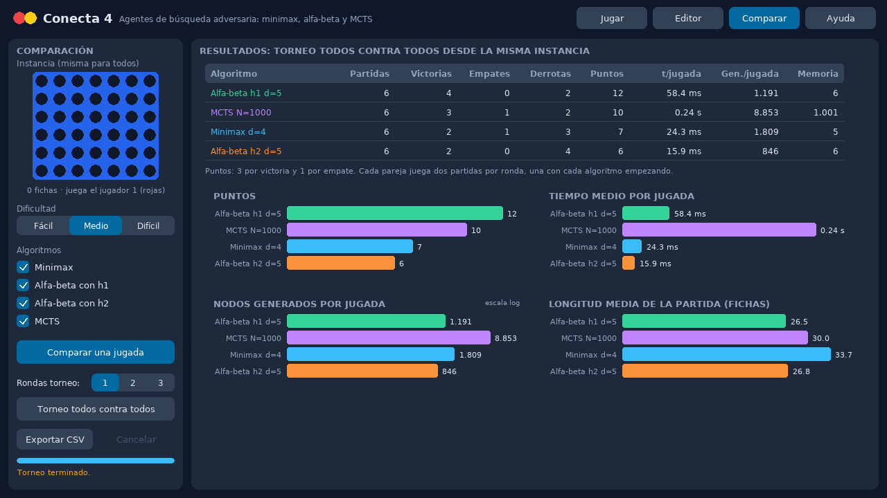
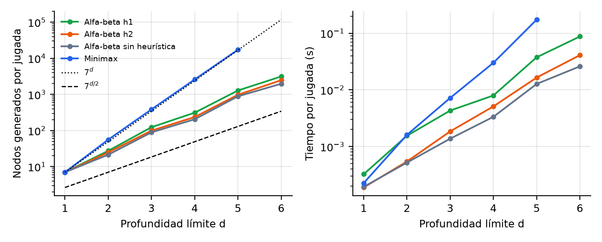

# Conecta 4 · Agentes de búsqueda adversaria

Proyecto final del curso **Representación y solución automática de problemas**
(Escuela de Ingeniería, Ciencia y Tecnología, Universidad del Rosario).

**Integrante:** Juan Sebastián Arroyo Zúñiga

Aplicación con interfaz gráfica interactiva en la que tres algoritmos de
búsqueda adversaria juegan al **4 en raya clásico** (7 columnas × 6 filas).
Permite ver de forma animada la partida y el proceso de búsqueda de cada
jugada, analizar el estado interno del algoritmo paso a paso y comparar los
algoritmos con métricas objetivas.

| Algoritmo | Tipo | Idea |
|---|---|---|
| Minimax con profundidad limitada | No informado | Recorre el árbol de juego usando solo la utilidad de los estados terminales |
| Alfa-beta con cutoff y función de evaluación (H-Minimax) | Informado | Minimax con poda y dos heurísticas: `h1` (ventanas de amenaza) y `h2` (control posicional) |
| Monte Carlo Tree Search (UCT) | Basado en simulación | Selección UCB1, expansión, partida aleatoria y retropropagación |

## Capturas de pantalla

**Jugar:** partida entre agentes con la animación de la búsqueda alfa-beta
(nodos en la frontera, en expansión, evaluados y podados).



**MCTS:** el tamaño de cada nodo y las barras muestran las simulaciones por
columna.



**Minimax y modo Humano vs Agente:**



**Editor de instancias:** estado inicial a mano, aleatorio con semilla o
desde un ejemplo.



**Modo de comparación:** los algoritmos deciden sobre la misma instancia.



**Torneo todos contra todos:**



## Instalación

Se necesita **Python 3.9 o superior**.

```bash
# 1. Entrar a la carpeta del proyecto
cd conecta4-agentes

# 2. (Recomendado) crear y activar un entorno virtual
python -m venv .venv
# Windows:
.venv\Scripts\activate
# macOS / Linux:
source .venv/bin/activate

# 3. Instalar las librerías
pip install -r requirements.txt
```

## Ejecución

Todos los comandos se ejecutan desde la carpeta del proyecto.

```bash
# Interfaz gráfica
python main.py

# Notebook de demostración (entorno, métodos y algoritmos)
jupyter notebook notebooks/Conecta4_demo.ipynb

# Pruebas automáticas
python -m pytest

# Experimentos del informe (reproducibles, con semillas fijas)
python experimentos/ejecutar_experimentos.py            # completo (~20 min)
python experimentos/ejecutar_experimentos.py --rapido   # versión corta (~2 min)
```

## Cómo usar la aplicación

La ventana tiene cuatro pestañas.

### Jugar

1. Elige el **modo** (Agente vs Agente o Humano vs Agente) y, para cada
   jugador, el **algoritmo**, la **dificultad** y la **heurística** (solo
   alfa-beta).
2. Pulsa **Iniciar**. En Humano vs Agente, haz clic en una columna.
3. Controles de reproducción:

| Control | Qué hace |
|---|---|
| Inicio / Final | Va al comienzo de la partida o a la última jugada calculada |
| Jugada ◀ ▶ | Retrocede o avanza una jugada completa |
| Paso ◀ ▶ | Retrocede o avanza **un paso de la búsqueda** |
| Iniciar / Pausar | Reproduce o detiene la animación |
| Velocidad | Pasos de la búsqueda por segundo |

Atajos: `Espacio` iniciar/pausar, `←` `→` paso a paso, `N` nueva partida.

El panel derecho muestra:

- **Proceso de búsqueda:** los primeros niveles del árbol. Gris = frontera
  (generado sin explorar), naranja = en expansión, azul = evaluado, rojo con
  X = podado, verde = mejor línea. En MCTS el tamaño del nodo son sus visitas.
- **Estado interno:** nodo actual, valor, α y β, tamaño de la frontera, nodos
  generados y expandidos, podas.
- **Métricas de la partida:** tiempo, nodos generados y expandidos, memoria y
  si la jugada es óptima.

En el tablero, sobre cada columna aparece el valor de esa jugada, y las fichas
transparentes numeradas son la línea que el algoritmo está analizando.

### Editor

Define el **estado inicial** del entorno: jugando fichas a mano, generando una
posición aleatoria (cantidad de fichas y semilla) o cargando un ejemplo
(*Gana en 1*, *Bloqueo obligado*, *Doble amenaza*, *Medio juego*, *Final de
partida*). Luego se usa para jugar o para comparar.

### Comparar

Ejecuta los algoritmos **sobre la misma instancia** y muestra tablas y
gráficas:

- **Comparar una jugada:** tiempo, nodos generados, nodos expandidos, memoria,
  podas y si la jugada es óptima.
- **Torneo todos contra todos:** victorias, empates, derrotas, tiempo y nodos
  por jugada y longitud de las partidas.
- **Exportar CSV:** guarda la tabla en la carpeta `resultados/`.

### Ayuda

Resumen de las reglas, los algoritmos, los colores y las métricas.

## Niveles de dificultad

| Algoritmo | Parámetro | Fácil | Medio | Difícil |
|---|---|---|---|---|
| Minimax | profundidad límite d | 2 | 4 | 6 |
| Alfa-beta | profundidad límite d | 2 | 5 | 8 |
| MCTS | simulaciones por jugada N | 200 | 1000 | 5000 |

Se cambian en `conecta4/config.py`.

## Métricas

| Métrica | Definición |
|---|---|
| Tiempo de ejecución | Segundos que tarda una decisión |
| Nodos generados | Estados creados con `resultado(s, a)` (en MCTS incluye las simulaciones) |
| Nodos expandidos | Nodos a los que se les generaron sus sucesores |
| Memoria | Máximo de nodos guardados a la vez: pila de la búsqueda en profundidad (minimax y alfa-beta) o tamaño del árbol (MCTS) |
| Longitud de la solución | Número de fichas con que termina la partida |
| ¿Óptima? | La jugada tiene el mismo valor que la mejor según el solucionador exacto (solo en posiciones con pocas casillas vacías) |
| Resultado | Victoria, empate o derrota |

## Resultados principales

Los experimentos completos están en `experimentos/` y en el informe.

| Torneo nivel medio (64 partidas por agente) | Victorias | Tiempo/jugada | Nodos/jugada | Memoria |
|---|---|---|---|---|
| Alfa-beta h1 d=5 | 87,5 % | 34 ms | 1.046 | 6 |
| Alfa-beta h2 d=5 | 64,1 % | 13 ms | 745 | 6 |
| MCTS N=1000 | 60,9 % | 0,21 s | 9.011 | 1.001 |
| Minimax d=4 | 28,1 % | 26 ms | 2.165 | 5 |

- Con profundidad 6, alfa-beta genera 37 veces menos nodos que minimax y
  devuelve el mismo valor.
- En 60 finales de partida, el porcentaje de jugadas óptimas sube con la
  dificultad: hasta 96,7 % en alfa-beta, 90,6 % en minimax y 89,4 % en MCTS.



## Estructura del proyecto

```
conecta4-agentes/
├── main.py                     Punto de entrada de la interfaz
├── requirements.txt            Librerías
├── conecta4/                   Entorno y algoritmos (sin interfaz)
│   ├── juego.py                Entorno Conecta4 (definición formal del juego)
│   ├── heuristicas.py          Funciones de evaluación h1 y h2
│   ├── agentes.py              Minimax, alfa-beta y MCTS
│   ├── datastruct.py           Árbol de búsqueda Monte Carlo
│   ├── metricas.py             Métricas y traza de la búsqueda
│   ├── solver.py               Solucionador exacto (optimalidad)
│   ├── config.py               Niveles de dificultad
│   ├── experimentos.py         Partidas, comparación y torneos
│   ├── utils.py                Episode y EnvfromGameAndPl2 (curso)
│   └── tiempos.py              compara_funciones (curso)
├── gui/                        Interfaz gráfica (pygame)
│   ├── app.py                  Ventana, pestañas y ciclo principal
│   ├── pantalla_jugar.py       Partida y animación
│   ├── pantalla_editor.py      Editor de instancias
│   ├── pantalla_comparar.py    Modo de comparación
│   ├── pantalla_ayuda.py       Ayuda
│   ├── sesion.py               Lógica de la partida (historial, hilos)
│   ├── vista_tablero.py        Dibujo del tablero
│   ├── vista_busqueda.py       Animación del árbol de búsqueda
│   ├── widgets.py              Botones, selectores, tablas y barras
│   └── tema.py                 Colores y tipografías
├── notebooks/Conecta4_demo.ipynb   Notebook de demostración
├── experimentos/               Experimentos del informe
│   ├── ejecutar_experimentos.py
│   ├── resultados/             Datos (CSV)
│   └── figuras/                Gráficas (PNG)
├── tests/                      Pruebas automáticas (pytest)
└── docs/                       Informe, presentación y capturas
```

## Uso del material del curso

El proyecto se construyó sobre el código del taller de **Juegos**:

| Proyecto | Material del curso |
|---|---|
| `Conecta4` (`juego.py`) | Misma interfaz de la clase `Triqui`: `estado_inicial`, `player`, `acciones`, `resultado`, `es_terminal`, `utilidad`, `render` |
| `AgenteMinimax` | Ejercicios 1 y 3 del notebook: `minimax_search`, `max_value`, `min_value` |
| `AgenteAlfaBeta` | `ChessFinalist1._H_minimax_alfa_beta`, `_is_cutoff`, `_evaluar` con `np.dot(pesos, valores)` |
| `AgenteMCTS` | `ChessFinalist2.program` (selección, expansión, simulación, backup), `play_policy`, `simulate_game` |
| `datastruct.py` | `valorNodo`, `NodoBusquedaJuego`, `ArbolBusquedaJuego` (`seleccionar_ucb`, `expandir`, `backup_value`, `ucb`) |
| `Agent`, `Random`, `PlfromAlgo` | Módulo `agents.py` |
| `EnvfromGameAndPl2`, `Episode` | Módulo `utils.py` |
| `compara_funciones` | Módulo `tiempos.py` |

## Repositorio en Git

El proyecto debe entregarse en un repositorio con historial de commits:

```bash
git init
git add .
git commit -m "Entorno Conecta4 y pruebas"
git branch -M main
git remote add origin <URL-del-repositorio>
git push -u origin main
```

## Referencias

- Allis, L. V. (1988). *A Knowledge-Based Approach of Connect-Four. The Game
  is Solved: White Wins* (tesis de maestría). Vrije Universiteit, Ámsterdam.
- Kocsis, L., & Szepesvári, C. (2006). Bandit based Monte-Carlo planning.
  *Machine Learning: ECML 2006* (LNCS 4212, pp. 282–293). Springer.
- Russell, S., & Norvig, P. (2020). *Artificial Intelligence: A Modern
  Approach* (4.ª ed.), cap. 5. Pearson.
